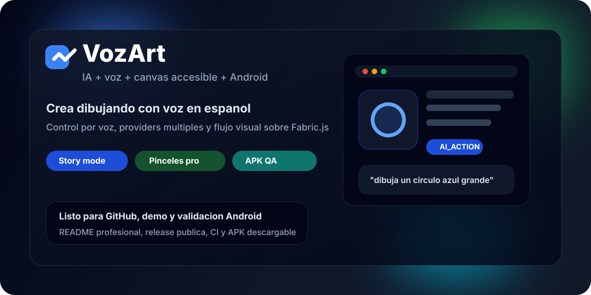
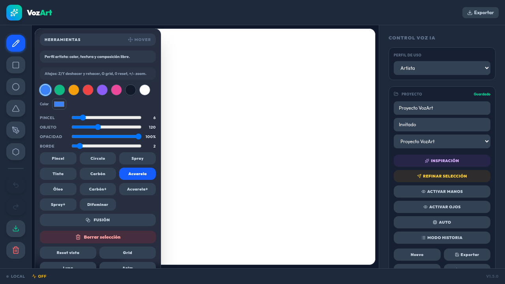

# VozArt

> Dibujo asistido por IA con control por voz, canvas accesible y APK Android lista para pruebas.






[](https://github.com/Rukawua26/vozart/releases/tag/v1.5.0-qa)
[](https://github.com/Rukawua26/vozart/actions)
[](https://github.com/Rukawua26/vozart)
[](https://github.com/Rukawua26/vozart/releases/tag/v1.5.0-qa)

[Descargar APK QA](https://github.com/Rukawua26/vozart/releases/tag/v1.5.0-qa) · [Ver Releases](https://github.com/Rukawua26/vozart/releases) · [Ver CI](https://github.com/Rukawua26/vozart/actions)

## Resumen

VozArt es una app de dibujo asistido por IA pensada para crear con voz o texto en espanol sobre un canvas accesible construido con Fabric.js. Combina herramientas visuales reales, providers de IA intercambiables, proyectos locales y una build Android para validar el producto fuera del navegador.

## Navegacion Rapida

- [Por Que Destaca](#por-que-destaca)
- [Lo Que Ya Hace](#lo-que-ya-hace)
- [Comandos De Ejemplo](#comandos-de-ejemplo)
- [Arranque Local](#arranque-local)
- [Descargar APK](#descargar-apk)
- [Arquitectura](#arquitectura)
- [Android](#android)
- [Calidad](#calidad)

## Por Que Destaca

- Voz + texto: dicta comandos en espanol o escribe manualmente.
- IA multi-provider: Gemini, OpenAI, Anthropic y Ollama.
- Canvas potente: formas, texto, imagen, capas, snapping, blend modes, zoom/pan y exportacion.
- Pinceles avanzados: oleo, acuarela, carbon, spray y difuminar.
- Story mode: la IA puede construir escenas visuales secuenciales.
- Accesibilidad real: alto contraste, lectura facil, UI grande, menos motion, atajos y anuncios `aria-live`.
- Android: APK via Capacitor para validar la experiencia en movil.

## Lo Que Ya Hace

| Area | Incluye |
| --- | --- |
| Entrada | Voz, texto manual, WebSocket en tiempo real |
| IA | `AI_ACTION`, fallback entre providers, contexto de sesion |
| Dibujo | Formas, texto, importacion de imagen, referencia, export PNG/JPG/SVG/JSON |
| Capas | Visibilidad, bloqueo, opacidad y reordenamiento |
| Productividad | Undo/redo, grid, lupa, zoom, pan, autosave |
| Accesibilidad | Navegacion por teclado, lector de pantalla, perfiles de uso |
| Android | Build release APK y configuracion Capacitor |

## Estado

El alcance original del producto esta implementado al 100%.

- Pinceles realistas + stylus
- Modos de fusion
- Story mode
- Smudge tool
- Snapping
- Modo auto/manual para acciones IA
- Proyectos locales con import/export y URL compartible
- APK Android de prueba

## Comandos De Ejemplo

VozArt entiende bien instrucciones como estas:

- `dibuja un circulo azul grande`
- `pon el fondo en negro`
- `anade texto que diga Hola Mundo`
- `genera una imagen de bosque magico`
- `refina el objeto seleccionado`
- `cuenta una historia visual sobre un viaje espacial`

## Stack

- Frontend: React 19, Vite, TypeScript, Fabric.js, Tailwind
- Backend: Express, WebSocket, TypeScript
- IA: Gemini, OpenAI, Anthropic, Ollama
- Mobile: Capacitor Android
- Testing: Vitest

## Arranque Local

```bash
npm install
cp .env.example .env
npm run dev
```

Abre `http://localhost:3000`.

## Descargar APK

- Release actual: `v1.5.0-qa`
- Descarga directa: `https://github.com/Rukawua26/vozart/releases/tag/v1.5.0-qa`
- Archivo incluido: `VozArt-QA-v1.5.0.apk`

## Variables De Entorno

```bash
GEMINI_API_KEY=
OPENAI_API_KEY=
ANTHROPIC_API_KEY=
OLLAMA_URL=http://localhost:11434
APP_ACCESS_TOKEN=
VITE_APP_ACCESS_TOKEN=
AI_PROVIDER_TIMEOUT_MS=15000
APP_URL=http://localhost:3000
TRUST_PROXY=
DISABLE_HMR=true
```

## Scripts

```bash
npm run dev
npm run build
npm start
npm run lint
npm test
npm run apk
```

## Arquitectura

- `server.ts`
  Backend real en dev/prod. Expone `/health`, `/api/providers`, WebSocket y fallback entre providers.
- `server/ai/`
  Registro de providers, validacion y parseo de respuestas IA.
- `src/App.tsx`
  Estado global, providers, proyectos, autosave, colaboracion y WebSocket.
- `src/components/CanvasInclusivo.tsx`
  Lienzo Fabric.js, herramientas, pinceles, accesibilidad y persistencia.
- `src/components/VoiceControl.tsx`
  Voz, historial, proveedores, proyectos y controles laterales.
- `src/services/`
  Contexto de sesion IA, stream manager y presets de perfil.

## Flujo De Voz A Canvas

1. El usuario habla o escribe un comando.
2. `VoiceControl` lo manda a `App.tsx`.
3. `App.tsx` envia el payload por WebSocket con provider y contexto.
4. `server.ts` valida la entrada y consulta al provider.
5. El provider responde con `AI_ACTION` o `ERROR`.
6. `CanvasInclusivo` ejecuta la accion y guarda el estado.

## Android

- Identidad dev actual: `com.vozartdev.app`
- Nombre visible actual de prueba: `VozArt QA`
- Build release:

```bash
npm run apk
```

- Para probar contra servidor en red local:

```bash
VITE_SERVER_URL=http://<tu-ip>:3000
```

## Calidad

Checklist tecnico base:

```bash
npm run lint
npm test
npm run build
```

CI:

- `.github/workflows/ci.yml`
- Ejecuta install, lint, test y build

## Limitaciones Actuales

Las limitaciones reales del MVP estan documentadas en:

- `spec/limitations-mvp.md`

## Documentacion Del Proyecto

- `spec/roadmap-fases-vozart.md`
- `spec/qa-checklist.md`
- `spec/constitution/tech-stack.md`
- `spec/constitution/mission.md`

## Roadmap Posterior

Guardado para la siguiente etapa con VPS/dominio:

- Persistencia en nube
- Cuentas y sync entre dispositivos
- Colaboracion en tiempo real mas robusta
- Accesibilidad profunda y tracking avanzado

## Licencia

Proyecto privado de trabajo.
